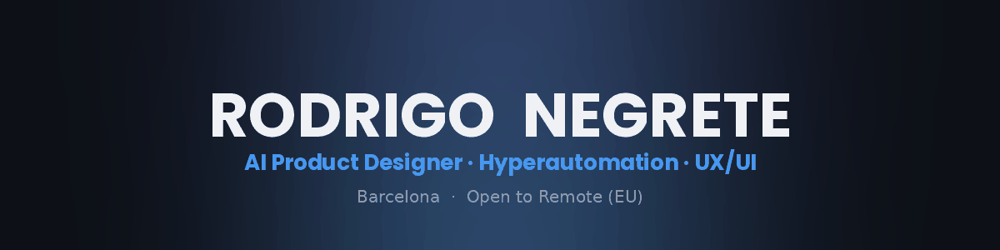
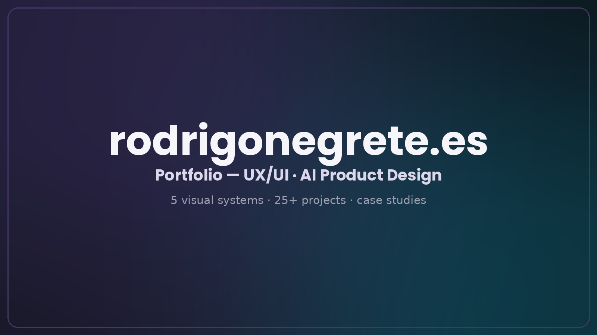
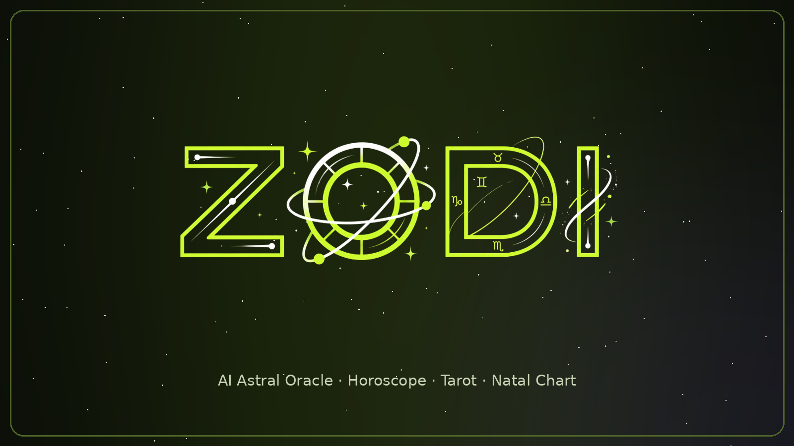
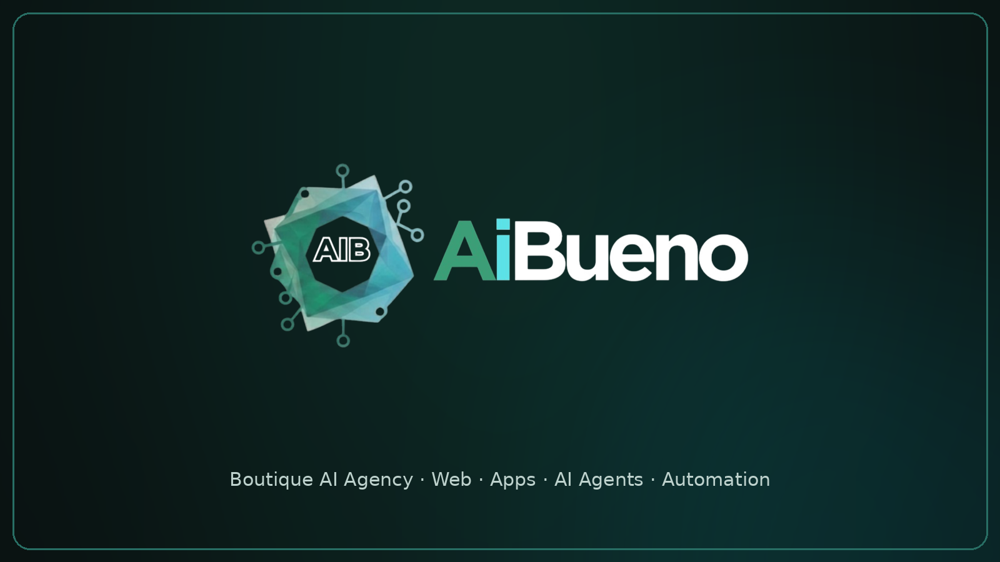
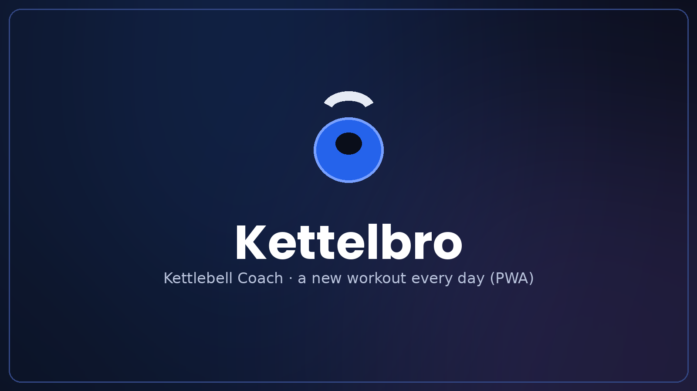

<!-- ============ HEADER ============ -->
<div align="center">



<a href="https://github.com/Ronegret">
  
</a>

<p>
  <a href="https://www.rodrigonegrete.es"></a>
  <a href="https://linkedin.com/in/rodrigonegretearos"></a>
  <a href="mailto:rodrigo.negrete.aros@gmail.com"></a>
  <a href="https://rodd.es"></a>
  
</p>

</div>

<!-- ============ ABOUT ============ -->
## 🧭 About

```ts
const rodrigo = {
  role:     "AI Product Designer & Hyperautomation Architect",
  based_in: "Barcelona 🇪🇸  ·  open to Remote (EU)",
  does:     ["UX/UI design", "front-end", "AI integration", "automation"],
  from:     "17+ yrs enterprise B2B → UX/UI bootcamp → MSc in AI Agents & Hyperautomation",
  motto:    "Ideas → working products, end to end.",
};
```

I design and ship digital products with **AI built into the flow** — from research and interface to AI agents, automation pipelines and front-end code. No hand-offs lost in translation.

---

<!-- ============ FEATURED ============ -->
## 📌 Featured Projects

<a href="https://www.rodrigonegrete.es"></a>
<h3 align="center">🌐 <a href="https://github.com/Ronegret/rn-portfolio-2026">My Portfolio</a> — <a href="https://www.rodrigonegrete.es">rodrigonegrete.es</a></h3>

<table>
<tr>
<td colspan="2" valign="top">
<a href="https://db.rodrigonegrete.es"></a>
<h3>🐉 <a href="https://github.com/Ronegret/dragonball_porfolio_RN">Capsule Corp</a></h3>
Gamified Dragon Ball Z portfolio — my career as a Saiyan power-up, driven by scroll.<br/>
<code>React</code> <code>Framer Motion</code> <code>GSAP</code> <code>Lenis</code> <code>Remotion</code><br/>
🌐 <b><a href="https://db.rodrigonegrete.es">Live demo →</a></b>
</td>
</tr>
<tr>
<td width="50%" valign="top">
<a href="https://rodd.es"></a>
<h3>🗂️ <a href="https://github.com/Ronegret/rodd">rodd.es</a></h3>
Open-source library of web resources — React components, animations & 3D.<br/>
<code>React</code> <code>Three.js</code> <code>Framer Motion</code><br/>
🌐 <b><a href="https://rodd.es">Live demo →</a></b>
</td>
<td width="50%" valign="top">
<a href="https://zodi.aibueno.es"></a>
<h3>🔮 <a href="https://github.com/Ronegret/zodi-pwa">ZODI</a></h3>
AI astral oracle — horoscope, tarot, natal charts & numerology.<br/>
<code>Next.js</code> <code>Capacitor</code> <code>Firebase</code> <code>AI</code><br/>
🌐 <b><a href="https://zodi.aibueno.es">Live demo →</a></b>
</td>
</tr>
<tr>
<td width="50%" valign="top">
<a href="https://aem.rodd.es"></a>
<h3>💍 <a href="https://github.com/Ronegret/events-planner">Events Planner</a></h3>
Operating system for weddings &amp; events — planner portal, couple view, offline-first.<br/>
<code>PWA</code> <code>Supabase</code> <code>offline-first</code><br/>
🌐 <b><a href="https://aem.rodd.es">Live demo →</a></b>
</td>
<td width="50%" valign="top">
<a href="https://play.dedicalo.es"></a>
<h3>🎵 <a href="https://github.com/Ronegret/playdedicalo">Dedícalo Play</a></h3>
Real-time multiplayer music game for groups.<br/>
<code>React</code> <code>Supabase</code> <code>AI</code><br/>
🌐 <b><a href="https://play.dedicalo.es">Live demo →</a></b>
</td>
</tr>
<tr>
<td width="50%" valign="top">
<a href="https://aibueno.es"></a>
<h3>🤖 <a href="https://github.com/Ronegret/aibueno">AIbueno</a></h3>
Boutique AI agency — web, mobile apps & AI agents (Barcelona).<br/>
<code>Next.js</code> <code>AI</code><br/>
🌐 <b><a href="https://aibueno.es">Live demo →</a></b>
</td>
<td width="50%" valign="top">
<a href="https://kettellbro.vercel.app"></a>
<h3>🏋️ <a href="https://github.com/Ronegret/kettelbro">Kettelbro</a></h3>
Kettlebell coach — a new 10–25 min research-backed workout each day (PWA).<br/>
<code>Next.js</code> <code>TypeScript</code> <code>Firebase</code><br/>
🌐 <b><a href="https://kettellbro.vercel.app">Live demo →</a></b>
</td>
</tr>
</table>

<div align="center"><sub>Also: <a href="https://github.com/Ronegret/PDFRodd">PDF Rodd</a> · <a href="https://github.com/Ronegret/EstudioCCSE">Estudio CCSE</a> · and 20+ more below</sub></div>

<details>
<summary><b>🧩 More products & lab experiments (20+)</b></summary>

<br/>

**🤖 AI & Automation**
- [Just Enjoy](https://github.com/Ronegret/Justenjoy_tfm) — hyperautomation travel planner · `n8n (27 nodes)` `GPT-4.1` `Next.js`
- [Invitoo](https://github.com/Ronegret/invitoo) — AI wedding invitations · `React` `Supabase`
- **Iberdata** — AI Center-of-Excellence business case · `n8n` `RAG` `Playwright`
- **ZODI BTO** — first conversational ZODI prototype · `Botpress`
- **Dedícalo** — AI-personalized songs · `Suno/Udio`

**🧪 Lab & Web experiments**
- [Vortex](https://github.com/Ronegret/vortex) — arcade mini-games portal · 🌐 [Live](https://vortex.rodd.es)
- [Alto Foco](https://github.com/Ronegret/Altofoco) — photography studio site, Barcelona · 🌐 [Live](https://altofoco.rodd.es)
- [La Óptica Online](https://github.com/Ronegret/laopticaonline) — e-commerce CRO prototype · 🌐 [Live](https://laopticaonline.rodd.es)
- [Jukaa Tattoo](https://github.com/Ronegret/Jukaatattoo) · 🌐 [Live](https://jukaatattoo.rodd.es)
- [Ink Madrid](https://github.com/Ronegret/inkmdrid) · 🌐 [Live](https://inkmadrid.rodd.es)
- [Ink BCN](https://github.com/Ronegret/inkbcn) · 🌐 [Live](https://inkbcn.rodd.es)
- [Estudio CCSE](https://github.com/Ronegret/EstudioCCSE) — Spanish citizenship exam simulator

**🎨 UX/UI & Branding case studies** <sub>(on my portfolio)</sub>
- ParaTuMundo — marketplace UX strategy · Te Atiendo — restaurant service UX · Aquae — water-saving app
- Travel of Vapers — brand identity & packaging · Tomapoly — physical board game

</details>

<div align="center">
<sub>📂 Full portfolio with visuals & case studies → <a href="https://www.rodrigonegrete.es">rodrigonegrete.es</a></sub>
</div>

---

<!-- ============ TECH STACK ============ -->
## 🛠️ Tech Stack

<div align="center">

<h3>🤖 AI &amp; Automation</h3>

&nbsp;&nbsp;&nbsp;
&nbsp;&nbsp;&nbsp;
&nbsp;&nbsp;&nbsp;
&nbsp;&nbsp;&nbsp;
&nbsp;&nbsp;&nbsp;
&nbsp;&nbsp;&nbsp;
&nbsp;&nbsp;&nbsp;
&nbsp;&nbsp;&nbsp;
&nbsp;&nbsp;&nbsp;

<br/><sub>+ Botpress · Suno · Midjourney · UiPath · Vapi</sub>

<h3>🎨 Design</h3>

&nbsp;&nbsp;&nbsp;
&nbsp;&nbsp;&nbsp;
&nbsp;&nbsp;&nbsp;
&nbsp;&nbsp;&nbsp;

<br/><sub>+ Spline · Elementor · design systems</sub>

<h3>💻 Front-end · Back-end · Cloud</h3>


<h3>📊 Analytics · Ops</h3>

&nbsp;&nbsp;&nbsp;
&nbsp;&nbsp;&nbsp;
&nbsp;&nbsp;&nbsp;
&nbsp;&nbsp;&nbsp;
&nbsp;&nbsp;&nbsp;
&nbsp;&nbsp;&nbsp;


</div>

---

<!-- ============ STATS ============ -->
## 📊 GitHub Activity

<table align="center" width="100%">
  <tr>
    <td width="50%" align="center">
      
    </td>
    <td width="50%" align="center">
      
    </td>
  </tr>
  <tr>
    <td width="50%" align="center">
      
    </td>
    <td width="50%" align="center">
      
    </td>
  </tr>
</table>

<div align="center">

</div>

---

<div align="center">

### 💬 Let's build something

I'm open to **AI Product Designer / AI Automation** roles (Remote EU · Barcelona) and freelance work.

📍 Barcelona · 📧 rodrigo.negrete.aros@gmail.com · 🌐 [rodrigonegrete.es](https://www.rodrigonegrete.es)


</div>
